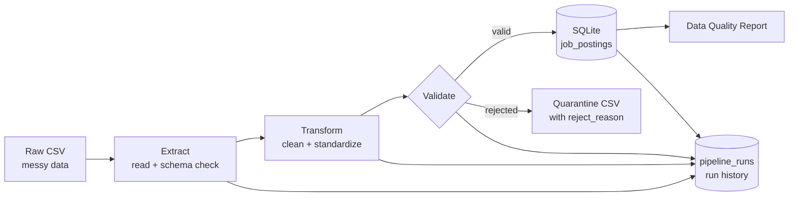

# Job Postings ETL Pipeline

A beginner-friendly data engineering project: a Python ETL pipeline that cleans messy job-posting data, validates it, and loads it into SQLite, with run tracking and an automated data-quality report.

## Architecture



## What it does

| Stage | Description |
|---|---|
| Extract | Reads the CSV as text, validates expected columns, logs empty values |
| Transform | Removes duplicates; standardizes titles, locations, job types; parses salary to LPA, experience to years, 3 date formats to ISO; normalizes skills |
| Validate | Business rules split rows into valid and rejected; rejected rows are quarantined with a reason |
| Load | Idempotent upsert into SQLite with a typed schema, primary key, indexes and a `loaded_at` audit column, in a single transaction |
| Track | Every run is recorded in `pipeline_runs` (status, counts, duration, error) |
| Report | Data-quality report generated from aggregate stats (template by default; optional LLM) |

## Results on the sample data

- 525 rows extracted, 25 duplicates removed, 25 rejected (missing date), 475 loaded
- Re-running the pipeline never creates duplicates (idempotent)

## Tech stack

Python, Pandas, SQLite, logging, Git

## How to run

```bash
git clone https://github.com/bhumikabhoyar/de-project-1-job-etl.git
cd de-project-1-job-etl
python -m venv venv
venv\Scripts\activate        # Windows
pip install -r requirements.txt
python generate_data.py      # creates the messy raw CSV
python main.py               # runs the pipeline
python check_db.py           # sample SQL queries
python check_runs.py         # run history
```

## Project structure

```
src/
  extract.py      read + validate raw data
  transform.py    cleaning functions
  validate.py     business rules + quarantine
  load.py         SQLite upsert
  run_tracker.py  pipeline run history
  ai_report.py    data-quality report
  logger.py       logging setup
main.py           pipeline entry point
```

## Concepts demonstrated

ETL design, separation of concerns, schema validation, data cleaning, idempotent loads, upserts, transactions, indexing, dead-letter quarantine, observability, graceful degradation.
